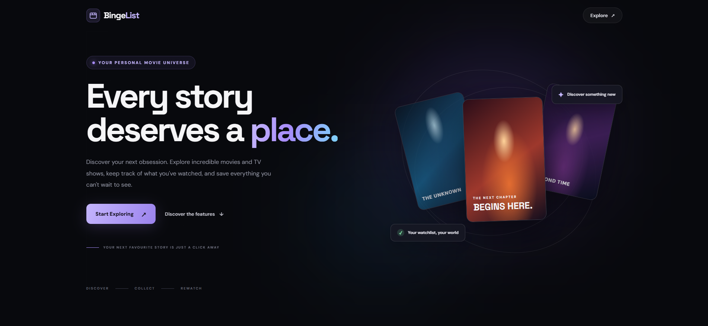
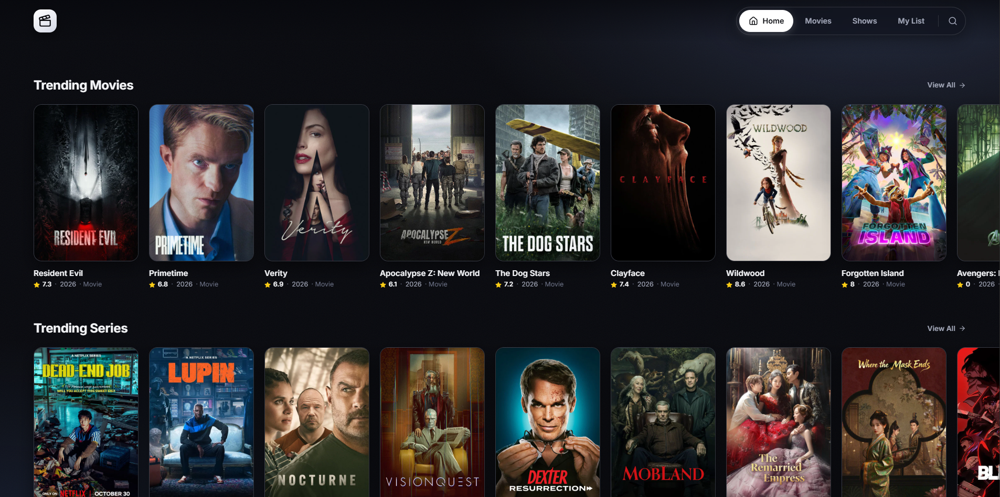
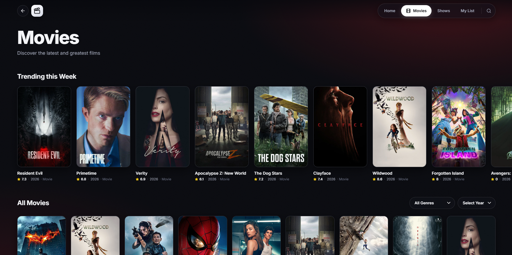
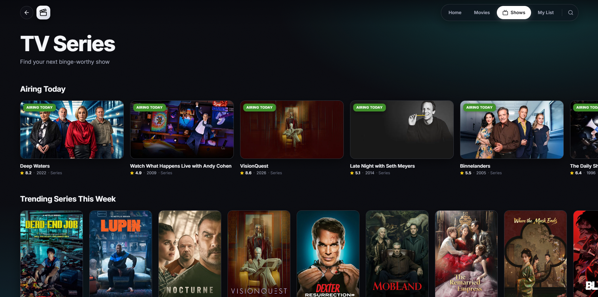
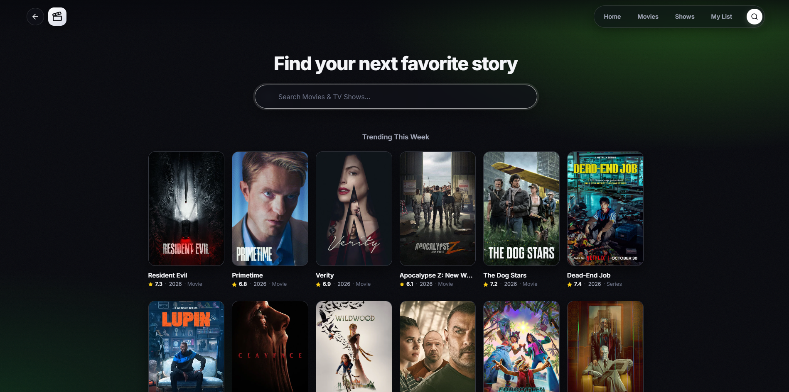
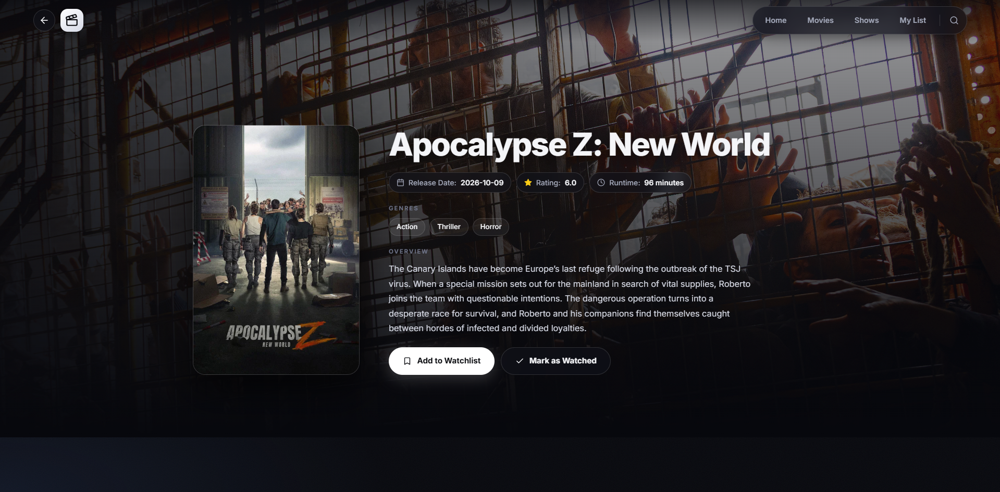
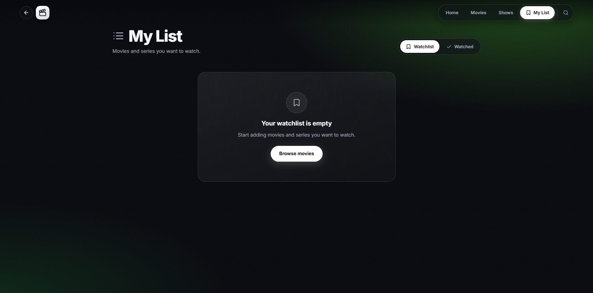
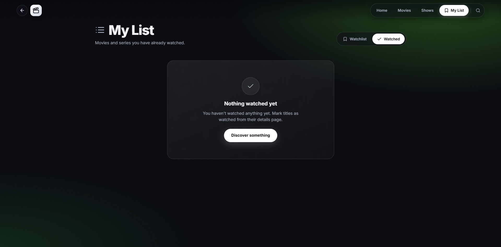

# 🎬 BingList — Discover. Track. Enjoy.

### Your personal universe of movies and TV shows.

Discover something new. Find stories worth watching. Build your own collection. Keep track of every movie and series you've watched.

**BingList** is a modern movie and TV discovery platform built with HTML, CSS, and Vanilla JavaScript, powered by the TMDB API.

From trending titles and personalised discovery filters to a persistent Watchlist and Watched collection, everything you need to organise your entertainment lives in one place.

---

<!-- Add your landing page screenshot here -->


<p align="center">
  <strong>Discover your next obsession. Your next story starts here.</strong>
</p>

---

## ✨ Features

### 🔥 Discover What's Trending

Stay connected with what's popular in the entertainment world.

- Explore trending movies and TV shows.
- Browse popular and top-rated movies.
- Discover upcoming movie releases.
- Explore TV shows airing today and currently on the air.
- Browse dedicated movie and TV discovery sections.

<!-- Add your homepage screenshot here -->


### 🎭 Discover Movies Your Way

Not sure what to watch? Narrow down your choices.

- Filter movies by genre.
- Filter movies by release year.
- Combine multiple filters to find exactly what you're looking for.
- Explore a dynamic collection of movie results.
- Browse more titles through infinite scrolling.

<!-- Add your movie discovery screenshot here -->


### 📺 A Dedicated TV Series Experience

Movies aren't the only stories worth discovering.

Explore a dedicated TV series section featuring:

- Trending TV shows.
- Popular series.
- Top-rated series.
- TV genre filtering.
- First air year filtering.
- Continuously loaded discovery results.

Movies and TV shows have their own discovery and pagination states while sharing reusable rendering functionality.

<!-- Add your TV series screenshot here -->


### 🔎 Global Search

One search. A whole universe of entertainment.

Search across movies and TV shows using TMDB's multi-search API.

- Dynamic search results.
- Debounced input to avoid unnecessary API requests.
- Search results displayed as interactive media cards.
- Quick navigation to individual title pages.
- Trending content displayed when the search field is empty.

<!-- Add your search screenshot here -->


### 🎞️ Detailed Movie & TV Pages

Every title deserves more than just a poster.

BingList uses a shared details page for both movies and TV shows.

Explore:

- Large cinematic backdrop images.
- Movie posters.
- Title and release information.
- Ratings.
- Runtime or episode runtime.
- Genres.
- Overview and descriptions.
- Watchlist and Watched actions.

Each title has its own URL parameters, allowing the same details page to handle both media types.

<!-- Add your details page screenshot here -->


### 📌 Your Personal Watchlist

Found something interesting? Save it for later.

Build your own collection of movies and TV shows that you want to watch.

- Add movies to your Watchlist.
- Add TV shows to your Watchlist.
- Remove titles whenever you want.
- Prevent duplicate entries.
- Keep your collection after refreshing the browser.

Your Watchlist is stored locally using the browser's `localStorage`.

<!-- Add your Watchlist screenshot here -->


### ✅ Keep Track of What You've Watched

Your personal entertainment history, organised.

- Mark movies as watched.
- Mark TV shows as watched.
- Maintain a separate Watched collection.
- Remove titles from your Watched list.
- Automatically move a title from Watchlist to Watched when marking it as watched.

No unnecessary manual organisation. Your collections stay organised automatically.

<!-- Add your Watched screenshot here -->


### ♾️ Infinite Scrolling & Pagination

Why stop discovering when there are more titles to explore?

BingList uses TMDB pagination alongside the browser's `IntersectionObserver` API to load additional results as you scroll.

- Load results page by page.
- Append new cards without replacing existing results.
- Prevent overlapping requests.
- Maintain separate pagination for movies and TV shows.
- Reset pagination when filters change.

More discovery, less waiting.

---

## 🛠️ Built With

| Technology | Purpose |
|---|---|
| HTML5 | Semantic page structure |
| CSS3 | Styling, layouts and responsive design |
| Vanilla JavaScript | Application functionality |
| TMDB API | Movie and TV metadata |
| Cloudflare Workers | API middleware |
| localStorage | Persistent personal collections |
| IntersectionObserver | Infinite scrolling |

### Why Vanilla JavaScript?

BingList is built without React, Vue, Angular, or another frontend framework.

The application uses native JavaScript features, reusable functions, DOM manipulation, asynchronous requests, and browser APIs to power its functionality.

---

## 🔐 API Architecture

The application communicates with TMDB through a Cloudflare Worker.

The Worker acts as middleware between the frontend and TMDB, keeping the API access token out of the client-side source code.

```text
             BINGLIST
                 |
                 v
        HTML / CSS / JavaScript
                 |
                 v
          Cloudflare Worker
                 |
                 v
              TMDB API
                 |
                 v
          JSON Response
                 |
                 v
          Rendered Content
```

The TMDB access token is stored as a Worker secret.

This keeps API credentials out of the frontend and centralises API communication.

---

## 💾 Data Persistence

Personal collections are stored in the browser using `localStorage`.

| Storage Key | Description |
|---|---|
| `watchlist` | Titles saved for later |
| `watched` | Titles already watched |

Each media item is identified using both its ID and media type.

This prevents conflicts between movies and TV shows that may share the same numeric ID.

**No application database is required for these personal collections.**

---

## 📂 Project Structure

```text
Movie-Discovery/
│
├── css/
│   ├── style.css
│   └── index.css
│
├── js/
│   ├── script.js
│   ├── details.js
│   ├── storage.js
│   ├── watchlist.js
│   └── watchedList.js
│
├── html/
│   ├── index.html
│   ├── homepage.html
│   ├── movies.html
│   ├── series.html
│   ├── searchpage.html
│   ├── details.html
│   ├── watchlist.html
│   └── watchedList.html
│
└── README.md
```

---

## 🚀 Getting Started

### 1. Clone the repository

```bash
git clone YOUR_REPOSITORY_URL
```

### 2. Open the project

Open the project in your preferred code editor.

### 3. Configure the Cloudflare Worker

Set up the Cloudflare Worker with your TMDB API access token stored as a secret.

Configure the frontend API base URL to point to your deployed Worker.

### 4. Run the application

Use a local development server such as VS Code Live Server to launch `index.html`.

---

## 🎬 A Few Things Under the Hood

Some of the core JavaScript concepts powering BingList:

- Fetch API and asynchronous JavaScript.
- Debouncing with `setTimeout()` and `clearTimeout()`.
- Event delegation for dynamically rendered cards.
- URL parameters using `URLSearchParams`.
- Array methods for filtering and collection management.
- JSON serialization and deserialization.
- Pagination and request-state management.
- Intersection Observer API.
- Reusable rendering and storage functions.

---

## 🙌 Credits

- Movie and TV metadata, posters, and images provided by [The Movie Database (TMDB)](https://www.themoviedb.org/).
- API middleware powered by [Cloudflare Workers](https://workers.cloudflare.com/).
- Learning resources and inspiration from [Scrimba's Fullstack Path](https://scrimba.com/fullstack-path-c0fullstack).

This product uses the TMDB API but is not endorsed or certified by TMDB.

---

<p align="center">
  <strong>Built for the love of movies, series, and everything in between. 🍿</strong>
  <br />
  <br />
  <em>Discover more. Save what you love. Never lose track of a story.</em>
</p>

<p align="center">
  Made with passion by <a href="https://github.com/MuhammadShariq05"><strong>Muhammad Shariq</strong></a>
</p>"# bingList" 
